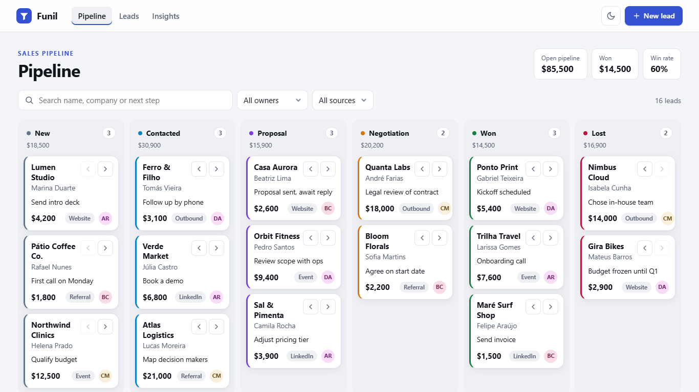
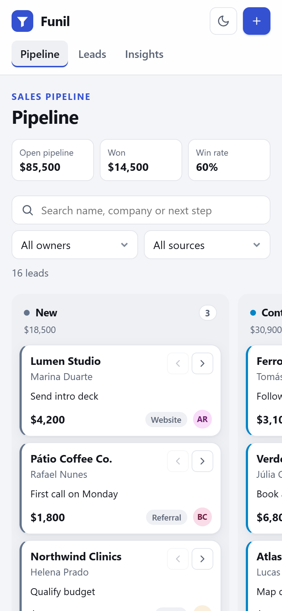

# Funil — Sales Pipeline CRM

A lightweight CRM for small sales teams: a kanban pipeline with drag and drop, filters you can share by URL, lead pages with an activity timeline, and an insights view. Built with React and TypeScript, with fictitious data stored in the browser.

**Live demo:** https://alissonlittig.github.io/funil-crm/





## Features

- **Kanban pipeline** with six stages (New → Lost). Move leads by dragging cards between columns, or with the arrow buttons on each card, which also work with a keyboard and on touch screens. Every move is announced to screen readers.
- **Filters in the URL** — search, owner and source are kept in the query string, so a filtered view can be bookmarked or shared.
- **Leads table** with sortable columns (`aria-sort`), collapsing to the essentials on small screens.
- **Lead page** — change stage, edit the next step and log notes on a timeline.
- **New lead form** with inline validation, focus moved to the first invalid field and errors linked with `aria-describedby`.
- **Insights** — open pipeline, win rate, average deal, funnel and value by stage, pipeline by owner and leads by source.
- **Light and dark themes** (follows the system setting, with a manual toggle that is remembered).
- **Responsive** from 390px phones to wide desktops, with no horizontal page scroll. On phones the board becomes a swipeable row of columns.

## Stack

| | |
|---|---|
| UI | React 18, TypeScript (strict), plain CSS with custom properties |
| Routing | React Router 6 (`HashRouter`, so deep links work on GitHub Pages) |
| State | `useReducer` + Context, persisted to `localStorage` |
| Build | Vite |
| Tests | Vitest + Testing Library (unit tests for the domain logic, integration tests for the main flows, including drag and drop) |
| Quality | ESLint with `typescript-eslint`, `react-hooks` and `jsx-a11y` |
| CI/CD | GitHub Actions: lint → test → build → deploy to GitHub Pages |

## Project structure

```
src/
  lib/leads.ts      pure domain logic: filtering, grouping, totals, validation
  lib/seed.ts       fictitious demo data
  store.tsx         reducer + context + persistence
  pages/            Board, Leads, LeadDetail, NewLead, Insights
  components/       filter bar (URL-synced), icons, avatar, theme toggle
  test/             Vitest suites
```

## Decisions

- **No drag-and-drop library.** The native HTML5 drag events are enough for column-to-column moves; the arrow buttons cover keyboard and touch users, which the native API does not.
- **Domain logic kept out of components**, so the rules (win rate counts only closed deals, a moved card goes to the top of its column, and so on) are tested without rendering anything.
- **Charts in CSS.** The insight bars are plain elements with real text values, which keeps the bundle small and the numbers readable by assistive tech.

## Running locally

```bash
npm ci
npm run dev      # http://localhost:5173
npm test         # run the test suites
npm run lint
npm run build
```

All data is fictitious and lives only in your browser. Use **Reset demo data** in the footer to start over.

## License

MIT
